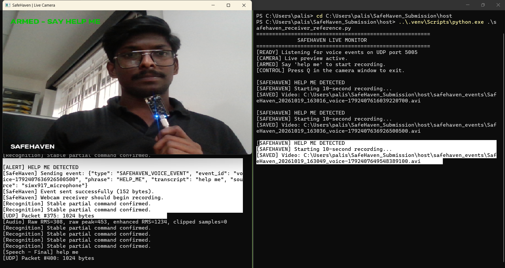
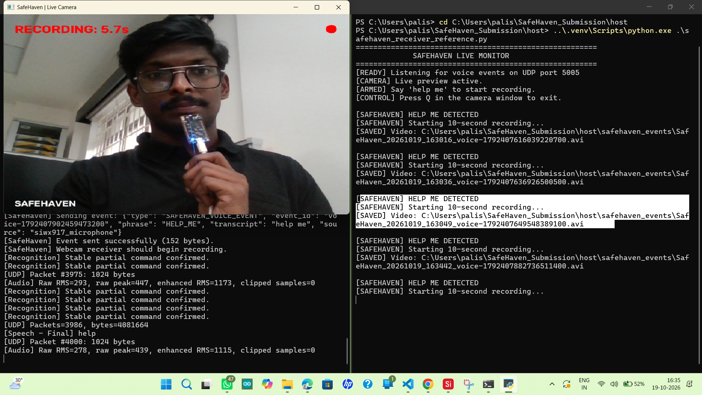
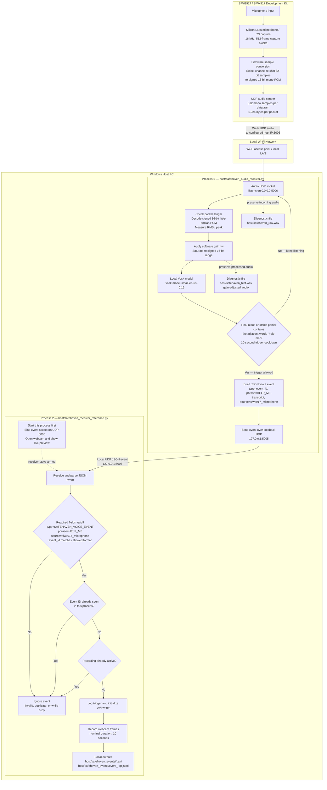

# SafeHaven

### Local-AI-Assisted Emergency Phrase Detection and Event-Triggered Video Evidence Capture with Silicon Labs SiWG917

SafeHaven is an experimental safety-monitoring prototype built around the **Silicon Labs SiWG917 / SiWx917 development kit**. It explores a hands-free workflow: when a configured emergency phrase such as **“help me”** is detected, the host application validates the resulting event and automatically records a short webcam clip, preserving a local video file and an event-log entry.

The project combines embedded microphone capture, Wi-Fi UDP audio transport, host-side speech recognition, structured event messaging, and event-triggered video recording. It is a prototype for experimentation and further development—not a certified emergency-response or security product.

> **Implementation accuracy:** The SiWG917 currently captures and streams microphone audio over Wi-Fi. **Speech recognition runs locally on the host PC using Vosk**, not on the SiWG917. On-device keyword spotting, remote mobile alerts, and a physical buzzer are future enhancements and are not implemented in the current version.

---

## Table of contents

- [Why SafeHaven?](#why-safehaven)
- [Potential applications](#potential-applications)
- [Live output demonstration](#live-output-demonstration)
- [Current features and future scope](#current-features-and-future-scope)
- [System architecture](#system-architecture)
- [End-to-end operating sequence](#end-to-end-operating-sequence)
- [Implementation details](#implementation-details)
- [Hardware and software requirements](#hardware-and-software-requirements)
- [Repository structure](#repository-structure)
- [Installation and host setup on Windows](#installation-and-host-setup-on-windows)
- [Configure and flash the SiWG917 firmware](#configure-and-flash-the-siwg917-firmware)
- [Run the prototype](#run-the-prototype)
- [Network interfaces and event format](#network-interfaces-and-event-format)
- [Generated evidence and diagnostic outputs](#generated-evidence-and-diagnostic-outputs)
- [Testing and validation](#testing-and-validation)
- [Troubleshooting](#troubleshooting)
- [Security, privacy, and safety limitations](#security-privacy-and-safety-limitations)
- [Roadmap](#roadmap)
- [Attribution and licensing](#attribution-and-licensing)

---

## Why SafeHaven?

Many home-monitoring cameras continuously record, rely on motion detection, or require someone to manually access an application to preserve an incident. SafeHaven explores a complementary approach: **use a configured spoken emergency phrase as an explicit trigger to start recording a short clip**.

The intention is to make evidence capture possible with minimal physical interaction. In the current prototype, the clip is stored on the host computer. It does not yet provide remote notification, cloud storage, or guaranteed emergency assistance.

The basic concept is:

1. A person says a configured phrase near the system microphone.
2. The SiWG917 development kit sends microphone audio to a nearby PC over Wi-Fi.
3. The PC runs local speech recognition and checks for the configured phrase.
4. When recognition qualifies as a trigger, the audio application creates a structured event.
5. The camera receiver validates the event and starts a 10-second webcam recording.
6. The video clip and event status are saved locally for later review.

This is an **event-triggered recording prototype**, not a replacement for a conventional continuously recording CCTV system. It can miss events if the phrase is not recognized, the network or host fails, or the camera is unavailable.

## Potential applications

### 1. Assistance for older adults, pregnant people, or someone alone at home

A person who is alone and has difficulty reaching a phone during an unexpected situation may be unable to unlock a device, open an app, or press a button. A voice-triggered interface could provide an additional way to initiate a recording workflow with minimal physical interaction.

For example, if a person says a configured phrase such as “help me,” SafeHaven can—in the current prototype—send microphone audio over Wi-Fi to the host PC, recognize the phrase locally, and trigger a short webcam recording. The resulting clip and event log are saved on that PC.

**Potential next step:** Send the event and recorded clip to a registered mobile device, together with a push notification and an audible alert or buzzer. This is a future enhancement; the present version does not send clips to a phone or contact emergency services.

### 2. Incident documentation and home security

During a possible intrusion, threat, or other concerning incident, a person may be able to say a configured phrase even when they cannot reach a physical control. A phrase-triggered recording could preserve a short video segment around the time of the trigger.

This could complement an existing home CCTV system by adding an intentional, voice-triggered capture mode. It should not be described as a guaranteed method for recording a crime: a person may be unable or unwilling to speak, the phrase may not be recognized, the microphone may be obstructed, or the host, camera, or network may not be operational.

**Potential next step:** Trigger a local buzzer or siren when a valid event starts recording, and optionally notify a registered mobile device. A buzzer may alert nearby occupants, but it could also escalate a situation; its behavior should be configurable and carefully evaluated.

### Why event-triggered video capture?

- **Hands-free trigger:** A spoken phrase is the main intended user interaction.
- **Local evidence storage:** The prototype saves a short clip and event log on the host PC.
- **Local speech processing:** Vosk performs recognition on the PC without requiring a cloud speech-recognition service.
- **Defined event workflow:** A recognized phrase becomes a structured event that the camera receiver checks before recording.
- **Extensible design:** Mobile alerts, buzzer control, and on-device keyword spotting can be explored as future work.

These are design goals and potential uses, not claims of certified safety, medical monitoring, guaranteed recognition, or proven crime prevention.

---

## Live output demonstration

### Silent end-to-end video

The silent demo is intended to show the actual workflow: the system is armed, the phrase **“help me”** is detected, an event is sent, and the camera receiver begins recording. The recording is screen-only, with no narration or music.

**Video:** Upload the MP4 as a GitHub Release asset and replace the URL below with the direct release asset URL.

[**▶ Watch the SafeHaven silent demo**](https://github.com/muralikrishnapalisetti/SiWG917-SafeHaven/releases)

### Output screenshot 1 — Phrase detection and event trigger

This screenshot shows the live camera in the recording state, the host-side recognition/event output, and the camera receiver reporting event-triggered recording. The visible `HELP ME DETECTED` and event-sent messages are evidence from the captured host application output.



### Output screenshot 2 — Recording in progress

This screenshot shows the webcam overlay indicating that recording is active and a countdown is in progress. The camera receiver terminal shows event handling and generated AVI file paths.



**What the demonstration establishes:** the captured run shows phrase detection, successful local event transmission, and recording initiated by the camera receiver. These screenshots document an example run; they do not establish recognition accuracy, response latency across all conditions, or production reliability.

> **Image locations:** The two screenshots are currently stored in the repository root, so the image links above intentionally use root-relative filenames. For the video, prefer a GitHub Release asset rather than committing a large MP4 into source history. Update the video link to the published release asset once the MP4 has been uploaded.

---

## Current features and future scope

| Capability | Status | Notes |
|---|---|---|
| Microphone capture on the SiWG917 development kit | Implemented in firmware project | Validate sample alignment/quality on target hardware |
| Wi-Fi audio transport | Implemented | UDP audio stream to host PC on port `5006` |
| Local speech recognition | Implemented on host | Vosk; not currently running on the SiWG917 |
| Configured emergency phrases | Implemented | `help me`, `please help me`, `help me please` |
| Structured trigger event | Implemented | JSON event sent locally to `127.0.0.1:5005` |
| Event-field validation | Implemented | Checks event type, phrase, source, and event-ID format |
| Short webcam recording | Implemented | OpenCV-based, nominally 10 seconds |
| Local event log | Implemented | JSON Lines (`.jsonl`) output |
| Send video to registered mobile | Planned | Requires secure transfer, device registration, and notification handling |
| Phone push alert / buzzer integration | Planned | Not present in the current implementation |
| Physical buzzer or siren | Planned | Requires suitable driver hardware, safe control logic, and tests |
| Keyword spotting on the SiWG917 | Planned / not integrated | Requires model, resource, and SDK feasibility evaluation |
| Authenticated and protected event transport | Future hardening | Current local UDP event is not authenticated |

---

## System architecture

This is the **current implemented architecture** in the firmware and host Python scripts. The SiWG917 captures and streams audio; speech recognition and the decision to trigger recording run on the Windows host. The two Python applications communicate with one another over host loopback UDP.



### How to read the diagram

1. **Capture on the board:** the firmware initializes the microphone/I2S path, captures blocks of 512 frames, converts the selected channel to signed 16-bit mono samples, and sends each 1,024-byte audio datagram to the host PC's configured LAN IPv4 address on UDP port `5006`.
2. **Receive and prepare audio:** `safehaven_audio_receiver.py` listens on UDP `5006`, checks packet length, decodes the PCM samples, records the original stream to `safehaven_raw.wav`, applies software gain with 16-bit saturation, and records the gain-adjusted stream to `safehaven_test.wav`.
3. **Recognize the phrase:** the host passes the gain-adjusted audio to the local Vosk model. Final recognition results are checked, and an early trigger may occur when a partial result containing the adjacent words `help me` remains stable across three checks. A 10-second trigger cooldown reduces repeated events.
4. **Create a local event:** when a match qualifies, the audio process sends JSON over loopback UDP to `127.0.0.1:5005`. This event includes `type`, `event_id`, `phrase`, `transcript`, and `source`; the event channel is between two processes on the same host, not a board-to-cloud service.
5. **Validate and record:** `safehaven_receiver_reference.py` parses the event and checks the expected type, phrase, source, and event-ID format. It ignores invalid messages, duplicate IDs kept in its in-memory cache, and events received while a recording is already active. A qualifying new event starts a nominal 10-second webcam recording.
6. **Save evidence and diagnostics:** the camera process writes an AVI video and appends status entries to `event_log.jsonl`. The audio process also prints packet and audio-level diagnostics. These are local development outputs, not a tamper-proof audit trail.

### Important implementation notes

- **Speech recognition is host-side.** The current firmware does not run the Vosk model or on-device keyword-spotting inference. Mobile alerts and a physical buzzer are not implemented.
- **Validate the I2S sample layout on the physical kit.** The firmware's current conversion selects channel 0 and shifts each 32-bit sample right by 16 bits. The source code explicitly treats the assumption that the valid sample bits occupy the upper 16 bits as a test conversion; confirm sample alignment, amplitude, and intelligibility on the real board before treating the PCM path as fully validated.
- **Configure the board's destination IP.** In `app.c`, replace `SERVER_IP_ADDRESS` with the host PC's LAN IPv4 address. The board sends audio to that address on UDP `5006`; do not set the board destination to `127.0.0.1`.
- **Start the camera receiver first.** It must already be listening on UDP `5005` and have successfully opened the webcam before the audio process can trigger it.
- **UDP is not a secure or guaranteed-delivery protocol by itself.** The current implementation does not add application-level encryption or authentication to the audio or JSON event. Use a trusted test network and protect the saved audio, video, and logs.

---

## End-to-end operating sequence

The following sequence view shows the runtime order after the project has been configured and both host applications are started.

```mermaid
sequenceDiagram
    autonumber
    participant Board as SiWG917 Firmware
    participant WiFi as Local Wi-Fi LAN
    participant Audio as Audio Receiver<br/>UDP 5006
    participant Model as Local Vosk Model
    participant CamRx as Camera Receiver<br/>UDP 5005
    participant Webcam as Host Webcam
    participant Files as Local Files

    Note over CamRx,Webcam: Start camera receiver first; it opens the webcam and waits for events.
    loop Continuous audio streaming
        Board->>WiFi: Send 1,024-byte PCM datagram to host IP:5006
        WiFi->>Audio: Deliver UDP audio packet
        Audio->>Files: Append raw audio to safehaven_raw.wav
        Audio->>Audio: Apply gain ×4 and 16-bit saturation
        Audio->>Files: Append processed audio to safehaven_test.wav
        Audio->>Model: Submit processed PCM
        Model-->>Audio: Partial or final transcript
        alt Transcript contains "help me" and trigger cooldown permits
            Audio->>CamRx: JSON voice event to 127.0.0.1:5005
            CamRx->>CamRx: Parse and validate event; check duplicate ID and recording state
            alt Event is valid, new, and receiver is idle
                CamRx->>Webcam: Capture frames for nominally 10 seconds
                CamRx->>Files: Save AVI and append event-status JSONL records
            else Invalid, duplicate, or busy
                CamRx->>CamRx: Ignore the event
            end
        else No qualifying trigger
            Audio->>Audio: Continue listening for the next packet
        end
    end
```

The actual result depends on microphone/I2S sample alignment, the host and board remaining connected, UDP packet arrival, recognition conditions, webcam availability, writable storage, and both host processes continuing to run.

---

## Implementation details

### 1. Embedded microphone capture and Wi-Fi UDP

The SiWG917 firmware is configured to capture microphone data and send audio packets to the host PC. The host destination address must be the PC's LAN IPv4 address, not `127.0.0.1`. The configured destination port is `5006`.

UDP is lightweight and simple to integrate, but does not provide delivery guarantees, retransmission, ordering, or encryption by itself. Packet loss or jitter can affect the reconstructed speech signal.

**PCM format expected by the receiver:** 16,000 samples/second, mono, signed 16-bit PCM.

The firmware's current conversion path includes an assumption about how microphone samples are aligned in the received 32-bit I2S words. Confirm the sample alignment and actual audio quality on the target hardware before relying on this format outside the current experiment.

### 2. Host-side Vosk speech recognition

The host receiver uses Vosk and the local model `vosk-model-small-en-us-0.15`. The configured phrase list includes:

- `help me`
- `please help me`
- `help me please`

The host application checks final results and a stable partial-result path. It includes a trigger cooldown to reduce immediate repeated events while the same utterance continues to appear in recognition output. This does not eliminate all false positives or missed detections; ambient noise, microphone quality, speaking style, sample conversion, and packet loss can affect results.

### 3. Structured event messaging

A recognized phrase is converted into a JSON event. In the current design this event is sent locally from the audio receiver to the camera receiver on the same PC. The camera receiver validates selected fields before initiating a recording. Field validation checks message structure; it does **not** authenticate the sender or make the event channel secure.

### 4. Event-triggered camera recording

The camera receiver uses OpenCV to access the default host webcam (camera index `0`, unless configured otherwise). On receiving an acceptable event, the application records a nominal 10-second video clip and writes it as an AVI file. The actual output depends on camera availability, frame capture, video-writer initialization, storage permissions, and whether the process remains running.

### 5. Diagnostics and audit trail

The host application prints UDP packet and audio-level diagnostics and writes WAV files used for troubleshooting. The camera receiver writes video clips and a JSONL event log. These outputs help developers determine whether the stream is arriving, whether an event was generated, and whether recording began. They are development diagnostics, not a tamper-proof security audit log.

---

## Hardware and software requirements

### Hardware

- Silicon Labs SiWG917 / SiWx917 development kit (BRD2605A).
- Windows host computer.
- Webcam available to OpenCV; default camera index is `0`.
- Local Wi-Fi access point/network that allows the development kit and host PC to communicate.
- USB and power connections required by the development kit.

### Software

- Simplicity Studio and a compatible Silicon Labs SDK/toolchain for the firmware project.
- Python 3.
- Python packages `vosk` and `opencv-python`.
- Vosk model `vosk-model-small-en-us-0.15`.

The host scripts use Python's standard library for UDP sockets, JSON, WAV processing, timing, paths, and log formatting.

---

## Repository structure

```text
.
├── README.md
├── firmware/
│   └── SafeHaven_UDP_Client/
│       ├── SafeHaven_UDP_Client.slcp
│       ├── app.c
│       ├── app.h
│       ├── config/
│       ├── autogen/
│       ├── resources/
│       ├── readme.md
│       └── SAFEHAVEN_README.md
├── host/
│   ├── safehaven_audio_receiver.py
│   └── safehaven_receiver_reference.py
├── safehaven-trigger-detected.png
├── safehaven-recording-active.png
├── submission_inventory.csv
└── .gitignore
```

- `firmware/SafeHaven_UDP_Client/` — Simplicity Studio firmware project and configuration.
- `host/safehaven_audio_receiver.py` — receives UDP PCM audio, writes diagnostics, runs Vosk, and sends the voice event.
- `host/safehaven_receiver_reference.py` — receives and validates voice events, displays the webcam, records clips, and logs event status.
- `firmware/SafeHaven_UDP_Client/SAFEHAVEN_README.md` — firmware-focused project notes.
- `submission_inventory.csv` — file inventory for the submission.
- `.gitignore` — excludes local environments, downloaded model files, runtime recordings/logs, and generated build output.

The Vosk model, virtual environment, captured WAV files, and generated video files are runtime assets and should generally not be committed as source files.

---

## Installation and host setup on Windows

Run commands from **PowerShell at the repository root** (the directory containing `README.md`).

### Step 1 — Create a virtual environment

```powershell
py -3 -m venv .venv
```

If `py` is unavailable, use the path to your installed Python executable to create the environment.

### Step 2 — Install host dependencies

```powershell
.\.venv\Scripts\python.exe -m pip install --upgrade pip
.\.venv\Scripts\python.exe -m pip install vosk opencv-python
```

Verify imports:

```powershell
.\.venv\Scripts\python.exe -c "import vosk, cv2; print('Vosk import: OK'); print('OpenCV:', cv2.__version__)"
```

### Step 3 — Download the Vosk model

1. Open the [official Vosk model list](https://alphacephei.com/vosk/models).
2. Download `vosk-model-small-en-us-0.15.zip`.
3. Extract it so the model is directly under `host/`, with this expected path:

```text
host/
└── vosk-model-small-en-us-0.15/
    ├── am/
    ├── graph/
    └── ...
```

The directory `host/vosk-model-small-en-us-0.15/am/` must exist. Avoid extracting the archive into an extra nested directory.

### Step 4 — Verify model placement

From the repository root:

```powershell
Test-Path ".\host\vosk-model-small-en-us-0.15\am"
```

Expected result:

```text
True
```

Verify model loading:

```powershell
.\.venv\Scripts\python.exe -c "from vosk import Model; Model(r'host/vosk-model-small-en-us-0.15'); print('Vosk model loaded')"
```

---

## Configure and flash the SiWG917 firmware

Open `firmware/SafeHaven_UDP_Client/SafeHaven_UDP_Client.slcp` in Simplicity Studio and confirm the required SDK components and toolchain are available.

### Configure the host IP address

In `firmware/SafeHaven_UDP_Client/app.c`, configure the destination host address and UDP port:

```c
#define SERVER_IP_ADDRESS "HOST IP ADDRESS HERE"
#define AUDIO_SERVER_PORT 5006U
```

Replace the placeholder with the host PC's **LAN IPv4 address** on the same network as the board. Do not use `127.0.0.1` as the board's destination; loopback refers to the board itself.

### Configure Wi-Fi credentials

The project currently has Wi-Fi client-profile definitions in `firmware/SafeHaven_UDP_Client/config/sl_net_default_values.h`, for example:

```c
#define DEFAULT_WIFI_CLIENT_PROFILE_SSID "Your_wifi_name"
#define DEFAULT_WIFI_CLIENT_CREDENTIAL "Your_wifi_password"
```

Use your test network's values in your local build configuration. **Never commit real Wi-Fi passwords or other secrets to a public repository.**

### Build and flash

1. Save the network configuration.
2. Build the firmware project in Simplicity Studio.
3. Resolve SDK, toolchain, or configuration errors.
4. Flash the built firmware to the supported development kit.
5. Inspect serial/log output to confirm Wi-Fi connection, microphone initialization, capture, and UDP send activity.

The I2S-to-PCM conversion should be validated on the target hardware. A successful compile alone does not prove the microphone samples are correctly aligned or suitable for speech recognition.

---

## Run the prototype

Start the camera receiver **before** the audio receiver. Open two separate PowerShell windows at the repository root.

### Window A — Camera event receiver

```powershell
.\.venv\Scripts\python.exe .\host\safehaven_receiver_reference.py
```

Typical startup output:

```text
[READY] Listening for voice events on UDP port 5005
[CAMERA] Live preview active.
[ARMED] Say 'help me' to start recording.
```

The camera receiver listens on UDP port `5005` and attempts to open the default webcam. If the camera does not open, close other applications that may be using it and check the selected camera index.

### Window B — Audio receiver and Vosk

```powershell
.\.venv\Scripts\python.exe .\host\safehaven_audio_receiver.py
```

Typical startup output:

```text
[SafeHaven] Vosk model loaded successfully.
[SafeHaven] Listening on UDP port 5006
[SafeHaven] Expected audio: 16000 Hz, mono, signed 16-bit PCM
[SafeHaven] Say 'help me' to trigger SafeHaven.
```

With the board configured and streaming, incoming packets should be visible in the logs. A remote address printed in logs depends on the local network.

### Trigger behavior

Speak one of the configured phrases near the development kit's microphone. When the host recognizes a qualifying phrase, it sends a JSON event to the camera receiver. A valid new event starts a nominal 10-second webcam recording.

- Press **Q** while the camera window is focused to exit the camera receiver.
- Press **Ctrl+C** in the audio receiver terminal to stop the audio application and close diagnostic WAV files.

Recognition is not guaranteed. Test in a controlled environment and record false triggers, missed detections, and latency before drawing reliability conclusions.

---

## Network interfaces and event format

| Direction | Protocol | Destination | Purpose |
|---|---|---|---|
| Development kit → host audio receiver | UDP | Host LAN IPv4, port `5006` | PCM audio packets |
| Audio receiver → camera receiver | UDP | `127.0.0.1:5005` | Local JSON voice event |
| Camera receiver listener | UDP | Host binds to port `5005` | Receive local event messages |

The audio receiver listens on `0.0.0.0:5006`, which binds to the host's IPv4 interfaces. The camera receiver also listens on port `5005`; in the current setup the event sender targets loopback because both processes run on the same PC. Keep the two Python applications on the same host for this configuration.

### Example event

This illustrates the event schema; the ID is an example and actual IDs are generated at runtime.

```json
{
  "type": "SAFEHAVEN_VOICE_EVENT",
  "event_id": "voice-123456789",
  "phrase": "HELP_ME",
  "transcript": "help me",
  "source": "siwx917_microphone"
}
```

The camera receiver checks that:

- `type` equals `SAFEHAVEN_VOICE_EVENT`.
- `phrase` equals `HELP_ME`.
- `source` equals `siwx917_microphone`.
- `event_id` is a 1–100 character string containing only letters, digits, underscores, or hyphens.

The `transcript` field may be included in logs, but is not one of the required validation fields. Validation enforces the expected message structure; it **does not authenticate the sender**.

---

## Generated evidence and diagnostic outputs

### Video and event log

The camera receiver creates output under:

```text
host/safehaven_events/
├── SafeHaven_<timestamp>_<event-id>.avi
└── event_log.jsonl
```

- The AVI file contains the nominal 10-second recording if video-writer initialization and frame capture succeed.
- `event_log.jsonl` stores one JSON object per line. Example statuses include `TRIGGER_RECEIVED`, `RECORDING_STARTED`, `RECORDING_COMPLETED`, and `RECORDING_FAILED`.
- Recent event IDs are remembered in process memory to help ignore duplicates while the receiver remains running.

### Audio diagnostic files

The audio receiver creates two WAV files under `host/`:

- `safehaven_raw.wav` — PCM received before software gain.
- `safehaven_test.wav` — audio after configured gain and 16-bit saturation.

Console diagnostics include packet counts, packet lengths, raw and enhanced RMS levels, peak levels, and the count of samples clipped by gain. These diagnostics can help troubleshoot packet delivery and signal amplitude, but rising RMS values alone do not prove correct sample alignment or accurate speech recognition.

Runtime WAV files, generated logs, and camera videos should generally stay out of version control unless explicitly prepared as sanitized demonstration assets.

---

## Testing and validation

The captured output images and video demonstrate the armed state, phrase detection, local event transmission, and camera recording initiation. These artifacts document an example run; they do not establish a measured accuracy or guaranteed field performance.

For reproducible evaluation, record the board and SDK version, host OS/Python version, number of trials, successful detections, false triggers, missed triggers, detection latency, packet loss, and whether the clip and log were produced. Do not publish accuracy or reliability values unless measured over a defined test set.

### Suggested validation matrix

| Test scenario | What to observe |
|---|---|
| Normal conversation | Whether unintended triggers occur |
| Each configured emergency phrase | Whether recognition initiates an event |
| Background noise | False triggers and missed detections |
| Board disconnect or Wi-Fi loss | Whether missing packets are visible in logs |
| Valid and malformed event messages | Valid events accepted; invalid fields rejected |
| Repeated event ID | Duplicate-event behavior |
| Video output | File creation, playback, and approximate 10-second duration |
| Webcam unavailable or storage unwritable | Clear failure handling and log output |

---

## Troubleshooting

| Symptom | Likely cause | What to check |
|---|---|---|
| `Vosk model not found or incomplete` | Model missing or nested incorrectly | Confirm `host/vosk-model-small-en-us-0.15/am/` exists |
| `ModuleNotFoundError: No module named 'vosk'` | Dependencies installed in a different Python environment | Use `.venv\Scripts\python.exe` to install and run |
| Audio receiver waits for UDP packets | Packets are not reaching port `5006` | Check board Wi-Fi, PC LAN IP, destination port, firewall, and board logs |
| Audio arrives but phrase does not trigger | Signal may be quiet, distorted, incorrectly aligned, or not speech-like | Inspect WAV files, levels, sample format, and microphone/I2S conversion |
| Camera preview fails | Webcam unavailable or already in use | Close other camera apps and check camera index |
| Address already in use | Another process owns port `5005` or `5006` | Stop previous SafeHaven processes or identify the listener |
| Event sent but recording does not begin | Camera receiver not running or event rejected | Inspect both consoles and verify event fields |
| Event accepted but video recording fails | Video writer or frame capture failed | Check camera preview, directory permissions, and receiver logs |
| Microphone samples unavailable | Capture/I2S initialization or data-ready path problem | Review serial logs and target-specific SDK configuration |

---

## Security, privacy, and safety limitations

SafeHaven is an experimental research prototype. It is not a certified alarm, medical alert, CCTV system, or emergency-response product.

- **No event authentication:** The current camera receiver validates selected fields but does not cryptographically authenticate who sent the event. A sender able to reach the listener could potentially spoof a message.
- **No application-level encryption:** Current UDP audio and event transport do not provide application-level encryption or integrity protection.
- **Local-storage dependency:** Current video evidence is stored on the host PC. There is no registered-phone delivery, remote backup, or cloud retention in the implemented workflow.
- **Recognition uncertainty:** Noise, accents, microphone placement, incorrect sample conversion, or packet loss can cause false positives or false negatives.
- **Availability dependencies:** Host shutdown, Wi-Fi outages, webcam access failures, or storage problems can stop the workflow.
- **Privacy responsibilities:** People should be informed when a camera is in use. Obtain appropriate consent, restrict access to stored clips, and set suitable retention/deletion rules.
- **Emergency limitations:** Do not rely on the prototype as the only way to request help. It does not contact emergency services and cannot guarantee that an emergency will be detected or recorded.

A deployment-oriented design would require threat modeling, authenticated and replay-resistant events, protected transport, access controls, reliable state reporting, robust failure handling, and systematic false-positive/false-negative testing.

---

## Roadmap

1. **Validate the embedded audio path:** Confirm I2S sample alignment, channel selection, PCM levels, and packet integrity on the physical kit.
2. **Quantify baseline performance:** Measure detection latency, false triggers, missed triggers, packet loss, and video-recording success over a defined test set.
3. **Mobile notifications and clip delivery:** Add secure transfer to a registered phone and push notifications. Define authentication, consent, retention, and recovery behavior.
4. **Buzzer / local alert:** Add a buzzer or siren driver triggered by a valid event, with configurable behavior and safe testing to avoid unintended escalation.
5. **Evaluate on-device keyword spotting:** Explore an appropriate model for the SiWG917's actual compute, memory, and SDK constraints; integrate only after it builds and is validated on hardware.
6. **Secure communications:** Add event authentication and replay protection, and evaluate supported protected transport options.
7. **Resilience and recovery:** Test Wi-Fi loss, process restart, camera failure, storage exhaustion, and event-log consistency.
8. **Reproducible release demo:** Keep a clean recording showing board activity, host recognition, event transmission, and saved video, with all claims limited to demonstrated behavior.

---

## Attribution and licensing

The firmware project is based on a Silicon Labs Wi-Fi example and has been adapted for the SafeHaven prototype. Preserve applicable original copyright notices and license terms, and review the licenses for the Silicon Labs SDK and third-party components before redistributing source files.

The inherited firmware `readme.md` describes procedures from the original Wi-Fi power-save example, including Energy Profiler and current measurements. Those inherited instructions are not evidence that power measurements were performed for SafeHaven.

The root-level `LICENSE` file is included. It applies only to original SafeHaven code and documentation authored by the project contributor, subject to the exceptions stated in that file. Silicon Labs SDK files, vendor examples, generated files, and third-party dependencies remain subject to their own applicable license terms; do not relicense third-party material contrary to those terms.

---

## Project summary

| Item | Current implementation |
|---|---|
| Project | SafeHaven |
| Embedded platform | Silicon Labs SiWG917 / SiWx917 development kit |
| Audio capture and transport | Board microphone path; Wi-Fi UDP to host port `5006` |
| Speech-recognition location | Host PC using Vosk |
| Trigger phrases | `help me`, `please help me`, `help me please` |
| Host event transport | Localhost UDP port `5005` |
| Event action | Event validation followed by nominal 10-second webcam capture |
| Saved evidence | AVI video clip and JSON Lines event log |
| Mobile notification | Planned, not implemented |
| Buzzer / siren | Planned, not implemented |
| On-device speech inference | Planned, not integrated |
