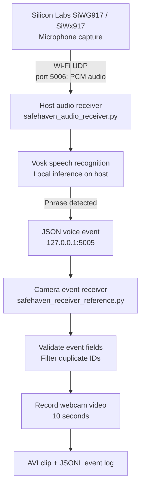

# SafeHaven
### Local-AI-Assisted Emergency Phrase Detection and Event-Triggered Video Evidence Capture with Silicon Labs SiWG917

SafeHaven is a prototype built around the **Silicon Labs SiWG917 / SiWx917 development kit**. It explores a hands-free emergency-phrase workflow: the development kit captures microphone audio and streams it over Wi-Fi to a nearby host computer; the host runs local speech recognition; and a recognized phrase produces an event that can trigger a webcam to save a short video clip and an event log.

> **Important implementation detail:** Speech recognition currently runs on the **host computer** using Vosk. The active SiWG917 firmware streams microphone audio over UDP; keyword-spotting inference on the SiWG917 itself is **not yet integrated**. For that reason, this README describes SafeHaven as local-AI-assisted—not as a completed on-device Edge AI implementation.

SafeHaven is an experimental prototype, not a certified emergency-response product. It should not be relied on as the only way to request help.

---

## 1. The Problem and the Proposed Approach

In an emergency, a person may not be able to unlock a phone, find an app, or operate a physical control. SafeHaven explores whether a short spoken phrase can initiate an evidence-capture workflow with minimal interaction.

The prototype is designed around four steps:

1. **Listen:** Capture microphone audio with the SiWG917 development kit.
2. **Recognize:** Stream audio to a host computer and use a local Vosk model to recognize a small set of configured phrases.
3. **Trigger:** Convert a qualifying recognition into a structured event message.
4. **Preserve:** Validate the event and save a 10-second webcam clip and a log entry.

### What is—and is not—implemented

| Capability | Current implementation |
|---|---|
| Microphone capture and Wi-Fi UDP audio streaming | Firmware implementation is present |
| Speech recognition | Host-side Vosk |
| Supported command phrases | `help me`, `please help me`, `help me please` |
| Event message | JSON over localhost UDP |
| Event validation | Type, phrase, source and event-ID format are checked |
| Video evidence capture | Host webcam, OpenCV, 10-second recording |
| On-device AI inference | Planned; not integrated in the active firmware |

---

## 2. System Architecture

The diagram shows the current data path. Audio travels from the board to the host over the local Wi-Fi network. The recognition event is then sent locally between two host applications.



### Component responsibilities

**A. SiWG917 firmware — microphone-to-UDP transport**

The firmware uses the configured microphone/I2S interfaces, converts captured samples to a 16-bit mono buffer, and sends audio packets to the configured host IPv4 address on UDP port `5006`. It is responsible for audio capture and transport, not the current speech-recognition decision.

**B. Host audio receiver — audio processing and recognition**

`host/safehaven_audio_receiver.py` listens on UDP port `5006`. It expects 16 kHz, mono, signed 16-bit PCM. It writes incoming audio to diagnostic WAV files, applies a configured software gain with 16-bit saturation, and passes enhanced audio to Vosk. It checks final and stable partial recognition results for the configured phrase.

**C. Voice event — recognition result to action**

When the phrase is detected, the host sends a JSON message to `127.0.0.1:5005`. The message includes an event type, generated ID, normalized phrase, transcript and source label. The event is sent locally because both Python applications run on the same computer in the current design.

**D. Camera receiver — validation and recording**

`host/safehaven_receiver_reference.py` listens on UDP port `5005`, opens the default webcam, and validates the incoming JSON event. A qualifying new event starts a 10-second recording. The receiver saves an AVI video and appends status information to a JSON Lines event log.

---

## 3. Repository Structure

```text
.
├── README.md
├── firmware/
│   └── SafeHaven_UDP_Client/
│       ├── SafeHaven_UDP_Client.slcp
│       ├── app.c
│       ├── app.h
│       ├── config/
│       ├── autogen/
│       ├── resources/
│       ├── readme.md
│       └── SAFEHAVEN_README.md
├── host/
│   ├── safehaven_audio_receiver.py
│   └── safehaven_receiver_reference.py
├── submission_inventory.csv
└── .gitignore
```

- **`firmware/SafeHaven_UDP_Client/`** — Simplicity Studio firmware project and its configuration.
- **`host/safehaven_audio_receiver.py`** — receives UDP PCM audio, records diagnostics, runs Vosk, and sends the voice event.
- **`host/safehaven_receiver_reference.py`** — receives and validates events, displays the webcam, records clips, and logs status.
- **`firmware/SafeHaven_UDP_Client/SAFEHAVEN_README.md`** — firmware-focused project notes.
- **`submission_inventory.csv`** — file inventory for the submission.
- **`.gitignore`** — excludes local environments, the downloaded speech model, recordings, runtime logs and generated build output.

The Vosk model, virtual environment, audio captures and recorded videos are local runtime assets; they are not required to be committed as source code.

---

## 4. Hardware and Software Requirements

### Hardware

- Silicon Labs SiWG917 / SiWx917 development kit (BRD2605A).
- Windows host PC.
- Working webcam accessible to OpenCV (default camera index: `0`).
- Wi-Fi access point/network that permits communication between the development kit and the host.

### Software

- Simplicity Studio with a compatible Silicon Labs SDK/toolchain for the firmware project.
- Python 3.
- Python package `vosk` for local speech recognition.
- Python package `opencv-python` for camera access and video recording.
- Vosk model `vosk-model-small-en-us-0.15`.

The host scripts use Python's standard library for UDP sockets, JSON, WAV handling, time measurements, paths and event-log formatting.

---

## 5. Host Setup on Windows

Run the following commands in **PowerShell from the repository root**. The repository root is the directory containing `README.md`.

### Step 1 — Create a virtual environment

```powershell
py -3 -m venv .venv
```

If the Python launcher is not available, create the environment using the full path to your installed Python executable. For example, on an installation under your local user profile:

```powershell
& "$env:LOCALAPPDATA\Programs\Python\Python314\python.exe" -m venv .venv
```

### Step 2 — Install Python dependencies

```powershell
.\.venv\Scripts\python.exe -m pip install --upgrade pip
.\.venv\Scripts\python.exe -m pip install vosk opencv-python
```

Verify that the libraries import correctly:

```powershell
.\.venv\Scripts\python.exe -c "import vosk, cv2; print('Vosk import: OK'); print('OpenCV:', cv2.__version__)"
```

### Step 3 — Download the Vosk model

1. Open the [official Vosk model list](https://alphacephei.com/vosk/models).
2. Download the English model archive named `vosk-model-small-en-us-0.15.zip`.
3. Extract the archive so the model directory is located directly under `host/`.

The expected directory is:

```text
host/
└── vosk-model-small-en-us-0.15/
    ├── am/
    ├── graph/
    └── ...
```

The important condition is that `host/vosk-model-small-en-us-0.15/am/` exists. The audio receiver checks for this directory before loading the model. Do not extract the archive into an extra nested directory, such as `host/vosk-model-small-en-us-0.15/vosk-model-small-en-us-0.15/`.

### Step 4 — Check the model

From the repository root, run:

```powershell
Test-Path ".\host\vosk-model-small-en-us-0.15\am"
```

Expected result:

```text
True
```

You can also verify model loading with:

```powershell
.\.venv\Scripts\python.exe -c "from vosk import Model; Model(r'host/vosk-model-small-en-us-0.15'); print('Vosk model loaded')"
```

---

## 6. Configure and Flash the SiWG917 Firmware

Open `firmware/SafeHaven_UDP_Client/SafeHaven_UDP_Client.slcp` in Simplicity Studio and confirm that the required SDK components and toolchain are available.

### Network settings

**1. Host computer IPv4 address**

In `firmware/SafeHaven_UDP_Client/app.c`, the current destination is configured using:

```c
#define SERVER_IP_ADDRESS "HOST IP ADDRESS HERE"
#define AUDIO_SERVER_PORT 5006U
```

Replace the placeholder with the host PC's **LAN IPv4 address** on the same network as the board. For example, if the PC's local address is `192.168.1.25`, configure that address in the firmware. This is only an example; use the address reported by your own network adapter.

Do not use `127.0.0.1` as the board's destination. Loopback refers to the device on which the address is used, so the board would not reach the PC through its own loopback address.

**2. Wi-Fi SSID and password**

The default client-profile definitions are in `firmware/SafeHaven_UDP_Client/config/sl_net_default_values.h`:

```c
#define DEFAULT_WIFI_CLIENT_PROFILE_SSID "Your_wifi_name"
#define DEFAULT_WIFI_CLIENT_CREDENTIAL "Your_wifi_password"
```

These are placeholders. Configure the values for the test network using the project's selected configuration method. **Never commit real Wi-Fi credentials** to a public repository or include them in screenshots.

**3. Build and flash**

1. Save your configuration.
2. Build the project in Simplicity Studio.
3. Resolve any SDK, toolchain or configuration errors before proceeding.
4. Flash the build to the supported development kit.
5. Open the board's serial/log output and confirm that Wi-Fi connection, microphone initialization, capture and UDP send operations report success.

The project source includes a note that the conversion from 32-bit I2S buffer samples to 16-bit mono PCM assumes the microphone sample bits occupy the upper 16 bits of each I2S word. The code labels this a test conversion and says it must be confirmed against the actual SiWx917 I2S receive implementation. Verify the sample alignment and resulting audio quality on the board before treating the captured stream as fully validated.

---

## 7. Run the Prototype

Start the camera receiver **before** the audio receiver. Use two separate PowerShell windows, both opened at the repository root.

### Window A — Camera receiver

```powershell
.\.venv\Scripts\python.exe .\host\safehaven_receiver_reference.py
```

The receiver listens on UDP port `5005` and then attempts to open the default webcam. Typical startup messages are:

```text
[READY] Listening for voice events on UDP port 5005
[CAMERA] Live preview active.
[ARMED] Say 'help me' to start recording.
```

If the camera cannot open, close other applications that may be using it and retry. The receiver supports the default camera index `0`.

### Window B — Audio receiver

```powershell
.\.venv\Scripts\python.exe .\host\safehaven_audio_receiver.py
```

The receiver loads the Vosk model and listens on UDP port `5006`. Typical startup messages include:

```text
[SafeHaven] Vosk model loaded successfully.
[SafeHaven] Listening on UDP port 5006
[SafeHaven] Expected audio: 16000 Hz, mono, signed 16-bit PCM
[SafeHaven] Say 'help me' to trigger SafeHaven.
```

With the board configured and streaming, the first incoming packet should cause a message similar to:

```text
[UDP] First packet from 192.168.1.XX:XXXXX (... bytes)
[SafeHaven] Audio stream active.
```

The address and source port shown will depend on your network. The host then processes the audio packets and checks recognition results for the configured phrases.

### Trigger behavior

The configured phrases are:

- `help me`
- `please help me`
- `help me please`

The audio receiver checks completed recognition results and also has a stability check for partial recognition. It uses a 10-second trigger cooldown to reduce repeated alerts from a continuing recognition result. Recognition is not guaranteed; speech clarity, background noise, sample conversion and packet delivery can affect results.

When a phrase is detected, the audio receiver prints an alert and sends a JSON event to the camera receiver. A valid new event starts a 10-second recording. In the camera window, press **Q** while the window is focused to exit. Press **Ctrl+C** in the audio receiver's terminal to stop it and close the diagnostic WAV files.

---

## 8. Network Ports and Data Formats

| Direction | Protocol | Address / port | Purpose |
|---|---|---|---|
| Development kit → host audio receiver | UDP | Host LAN IPv4, port `5006` | PCM audio packets |
| Audio receiver → camera receiver | UDP | `127.0.0.1:5005` | Local JSON voice event |
| Camera receiver listener | UDP | Port `5005` | Receives events from the local audio receiver |

The audio receiver binds to `0.0.0.0:5006`, which listens on the host's IPv4 interfaces. The event receiver also binds to `0.0.0.0:5005`; in the current arrangement, the audio application sends its event to loopback (`127.0.0.1`). Keep both apps on the same host for this setup.

The Python audio receiver expects 16 kHz, mono, signed 16-bit PCM. The firmware's current conversion path needs hardware validation, as noted above.

### Example valid event

The following example illustrates the JSON structure sent by the audio receiver. The ID shown is illustrative; actual IDs are generated at runtime.

```json
{
  "type": "SAFEHAVEN_VOICE_EVENT",
  "event_id": "voice-123456789",
  "phrase": "HELP_ME",
  "transcript": "help me",
  "source": "siwx917_microphone"
}
```

The camera receiver checks these fields:

- `type` must equal `SAFEHAVEN_VOICE_EVENT`.
- `phrase` must equal `HELP_ME`.
- `source` must equal `siwx917_microphone`.
- `event_id` must be a string of 1–100 characters containing only letters, digits, underscores or hyphens.

The `transcript` field is recorded in logs when provided, but it is not one of the required validation fields. For example, a missing or unexpected `source` value causes the event to be rejected. This validation helps enforce message structure, but **it does not authenticate the sender**.

---

## 9. Output Files and Diagnostics

### Camera output

The camera receiver creates the following output directory automatically:

```text
host/safehaven_events/
├── SafeHaven_<timestamp>_<event-id>.avi
└── event_log.jsonl
```

- The AVI file contains a 10-second recording when video writer initialization and frame capture succeed.
- `event_log.jsonl` contains one JSON object per line. Example event states include `TRIGGER_RECEIVED`, `RECORDING_STARTED`, `RECORDING_COMPLETED` or `RECORDING_FAILED`.
- Recent event IDs are remembered in process memory to ignore duplicate IDs received while the application is running.

### Audio diagnostics

The audio receiver creates two WAV files under `host/`:

- `safehaven_raw.wav` — received PCM written to a WAV file before software gain.
- `safehaven_test.wav` — audio after the configured gain and 16-bit saturation.

It also prints packet counts, packet lengths, raw and enhanced RMS levels, peak levels and a count of samples clipped by gain. These diagnostics help determine whether audio packets arrive and whether the received signal has usable amplitude. Inspect the recordings for audio quality; a rising RMS level alone does not prove correct sample alignment or accurate speech recognition.

Runtime WAV files, logs, and videos are local test artifacts. They should not be committed by default.

---

## 10. Troubleshooting

| Symptom | Likely cause | What to check |
|---|---|---|
| `Vosk model not found or incomplete` | Model is missing or nested in an extra directory | Confirm `host/vosk-model-small-en-us-0.15/am/` exists |
| `ModuleNotFoundError: No module named 'vosk'` | Dependencies were installed into a different Python environment | Run installation and the script with `.venv\Scripts\python.exe` |
| Audio receiver repeats `Waiting for UDP audio packets...` | No audio packets are reaching port 5006 | Check board Wi-Fi connection, host LAN IPv4 setting, UDP destination port, firewall rules and board logs |
| Audio packet messages appear, but no phrase triggers | Audio may be quiet, distorted, incorrectly aligned or not speech-like | Inspect WAV files, RMS/peak diagnostics, sample format and microphone/I2S conversion |
| `[CAMERA ERROR]` or the live preview does not appear | Camera unavailable or already in use | Close other camera apps; verify the camera works and that index 0 is appropriate |
| Address already in use / bind failure | Another process is using port 5005 or 5006 | Stop an earlier SafeHaven instance or identify the process bound to that port |
| Event is sent but video does not start | Camera receiver may not be running or event validation failed | Inspect both terminal windows and compare type, phrase, source and event ID with the event contract |
| Event is accepted but recording fails | OpenCV could not initialize the video writer or no valid frames were available | Check the camera window, output folder permissions and camera receiver messages |
| Board reports no or timed-out microphone samples | Capture initialization, microphone/I2S setup or data-ready signaling may be failing | Review serial output and validate the configured audio path in the target SDK and hardware |

---

## 11. Verification and Test Status

The following host-side checks have been performed during development:

- Python environment created and the `vosk` and `cv2` imports succeeded.
- Vosk model loaded successfully from the expected directory.
- Both host scripts passed Python syntax compilation.
- Camera receiver launched and displayed the live preview on the development PC.
- Audio receiver loaded its model and bound to UDP port `5006`.

The board was not available during the latest host setup checks, so those checks **do not prove a fresh end-to-end run from the physical microphone through recognition to video recording**. Verify firmware build/flash, board microphone samples, actual UDP audio packet delivery, speech detection and event-triggered clip generation together on the intended hardware before publishing quantitative performance claims.

For a structured evaluation, record the date, hardware/SDK version, host OS/Python version, number of trials, successful detections, false triggers, detection latency, packet loss and whether the video/log files were created. Do not report accuracy, latency or reliability figures until they have been measured.

### Suggested validation matrix

| Test scenario | What to observe |
|---|---|
| Normal conversation | Whether it avoids triggering unintentionally |
| Each configured emergency phrase | Whether recognition triggers an event |
| Background noise | False triggers and missed detections |
| Board disconnect or Wi-Fi loss | Whether the system reports missing packets clearly |
| Valid and malformed event messages | Acceptance of valid format and rejection of invalid fields |
| Repeated event ID | Duplicate-event behavior |
| Video output | File creation, playable clip and approximate 10-second duration |

---

## 12. Security, Privacy and Safety

- **No event authentication:** the current UDP event listener accepts messages based on field validation only. A sender that can reach the listener may be able to spoof an event.
- **No transport encryption:** UDP audio and local event packets do not have application-level confidentiality or integrity protection.
- **Network exposure:** keep testing on a trusted local network. Restrict inbound traffic to the ports needed for the prototype; do not expose the listeners to the public internet.
- **Camera privacy:** inform people when a camera is in use, obtain appropriate permissions, limit retention, and restrict access to recordings and logs.
- **Reliability:** noise, accents, microphone issues, bad sample conversion, packet loss, host shutdown or camera failures can prevent or delay an event.
- **Emergency use:** this is an experimental research prototype, not a certified safety system. It must not replace emergency services or another dependable means of asking for help.

A production-oriented version would need authenticated event messages, replay protection, secure transport where supported, fail-safe behavior, retention controls, and systematic false-positive/false-negative testing.

---

## 13. Roadmap

1. **Validate the hardware audio path.** Confirm I2S sample alignment, channel selection, PCM amplitude and packet integrity using the actual board.
2. **Measure the current baseline.** Quantify detection latency, false triggers, missed triggers, packet loss and recording reliability over a defined test set.
3. **Evaluate on-device keyword spotting.** Explore a compact model compatible with the SiWG917's actual compute, memory and SDK capabilities. Integrate only after a build and on-device tests succeed.
4. **Harden event transport.** Add authentication and replay protection and assess encrypted transport options.
5. **Improve operational behavior.** Test network loss, process restart, camera failure, storage availability and event-log consistency.
6. **Prepare a reproducible demonstration.** Capture an unedited run showing the board, live audio stream, detected phrase, event receipt and saved video. Publish only measured results and real evidence.

---

## 14. Attribution

The firmware project is based on a Silicon Labs Wi-Fi example and has been adapted for the SafeHaven prototype. Preserve applicable original copyright notices and license terms. Review the relevant Silicon Labs SDK and third-party component licenses before redistributing SDK source files.

The firmware's inherited `readme.md` describes procedures from the original Wi-Fi power-save example, including Energy Profiler and current measurements. Those inherited procedures are not evidence that power measurements were performed for SafeHaven.

---

**Project:** SafeHaven  
**Embedded platform:** Silicon Labs SiWG917 / SiWx917  
**Current recognition location:** Host computer (Vosk)  
**Board-to-host transport:** Wi-Fi UDP, port 5006  
**Host event transport:** Localhost UDP, port 5005  
**Trigger phrases:** `help me`, `please help me`, `help me please`  
**Evidence output:** AVI video clip and JSON Lines event log  
