# SafeHaven

**Local-AI Emergency Phrase Detection and Event-Triggered Video Evidence Capture with Silicon Labs SiWG917**

SafeHaven is a safety-focused prototype built around the Silicon Labs SiWG917 / SiWx917 development kit. The board streams microphone audio over Wi-Fi to a nearby computer, where local speech recognition listens for a configured emergency phrase. A recognized phrase generates a structured event that triggers a webcam to save a short video clip and an event log.

> **Implementation accuracy:** Speech recognition currently runs on the host computer using Vosk. The active SiWG917 firmware streams microphone audio; on-device/MCU keyword inference is **not yet integrated**. This project is therefore described as local-AI-assisted, rather than claiming that AI inference runs on the SiWG917.

## Why SafeHaven

In an emergency, a person may not be able to reach or operate a phone. SafeHaven explores a hands-free voice-triggered workflow that can preserve a short video record when a configured phrase is detected. It is a prototype for experimentation—not a certified emergency-response or surveillance product.

## System Architecture

```mermaid
flowchart LR
    A["SiWG917 development kit<br/>Microphone capture"] -->|"PCM audio · Wi-Fi UDP · port 5006"| B["Host audio receiver"]
    B --> C["Vosk speech recognition<br/>Local host inference"]
    C -->|"Configured phrase detected"| D["Structured JSON event<br/>localhost UDP · port 5005"]
    D --> E["Camera event receiver<br/>Event validation"]
    E --> F["Webcam recording<br/>10-second clip"]
    F --> G["AVI video + JSONL event log"]
```



Both host applications run on the same computer in the current configuration. The board must be able to send UDP audio packets to that computer on port `5006`.

## Current Features

- Microphone audio capture and Wi-Fi UDP streaming by the SiWG917 firmware.
- Host-side speech recognition with a locally stored Vosk model; recognition does not require sending audio to a cloud speech service.
- Configured phrase variants: `help me`, `please help me`, and `help me please`.
- JSON event transfer from the audio receiver to the camera receiver over localhost UDP.
- Event-field validation and duplicate-event filtering in the camera receiver.
- Event-triggered 10-second webcam recording using OpenCV, with an AVI clip and JSONL event log.
- Basic audio diagnostics, including packet counts, audio-level measurements, and WAV captures.

## Prototype Status

| Area | Status |
|---|---|
| Host dependencies and Vosk model loading | Verified on Windows with Python 3.14 |
| Python syntax of both host scripts | Verified |
| Camera receiver startup and live preview | Verified |
| Audio receiver startup and UDP listener | Verified |
| Full live microphone-to-camera test with the SiWG917 board | Requires validation with the board connected |
| On-device/MCU keyword inference | Planned; not integrated in the active firmware |

## Hardware and Software

**Hardware**
- Silicon Labs SiWG917 / SiWx917 development kit (BRD2605A).
- Windows host computer with a webcam.
- Wi-Fi access point/network shared by the board and host.

**Software**
- Simplicity Studio and the compatible Silicon Labs SDK/toolchain for firmware.
- Python and the packages listed in [`host/requirements.txt`](host/requirements.txt).
- Vosk speech-recognition model: `vosk-model-small-en-us-0.15`.
- OpenCV for webcam capture and video writing.

## Repository Layout

```text
.
├── README.md
├── firmware/
│   └── SafeHaven_UDP_Client/
│       ├── SafeHaven_UDP_Client.slcp
│       ├── app.c
│       ├── config/
│       └── SAFEHAVEN_README.md
├── host/
│   ├── requirements.txt
│   ├── safehaven_audio_receiver.py
│   └── safehaven_receiver_reference.py
└── submission_inventory.csv
```

The Vosk model, local virtual environment, recordings, and runtime logs are intentionally not tracked in Git.

## Setup and Run on Windows

### 1. Create a Python environment

Run these commands from the repository root:

```powershell
py -3 -m venv .venv
.\.venv\Scripts\python.exe -m pip install --upgrade pip
.\.venv\Scripts\python.exe -m pip install -r host/requirements.txt
```

If the `py` launcher is unavailable, use the full path to your installed `python.exe` to create the virtual environment.

### 2. Download the Vosk model

1. Open the [official Vosk model page](https://alphacephei.com/vosk/models).
2. Download `vosk-model-small-en-us-0.15`.
3. Extract the model directory under `host/`.

The resulting path must be:

```text
host/vosk-model-small-en-us-0.15/am/
host/vosk-model-small-en-us-0.15/graph/
```

The model directory must contain an `am` subdirectory. The model is not included in this repository because it is a separate download and should not be committed as project source.

### 3. Configure and flash the firmware

1. Open `firmware/SafeHaven_UDP_Client/SafeHaven_UDP_Client.slcp` in Simplicity Studio.
2. In `app.c`, set `SERVER_IP_ADDRESS` to the host computer's LAN IPv4 address.
3. Configure the Wi-Fi SSID and password in the relevant firmware configuration file.
4. Build and flash the firmware using a compatible Silicon Labs SDK and toolchain.

Use placeholders in shared code and keep Wi-Fi credentials private. The firmware build and board-side stream must be validated in the target development environment.

### 4. Start the camera receiver first

Open a PowerShell window at the repository root:

```powershell
.\.venv\Scripts\python.exe .\host\safehaven_receiver_reference.py
```

The camera window should open and show that the receiver is armed. The receiver listens on UDP port `5005` and attempts to record a 10-second clip when a valid event arrives. Press `Q` while the camera window is focused to exit.

### 5. Start the audio receiver

Open a second PowerShell window at the repository root:

```powershell
.\.venv\Scripts\python.exe .\host\safehaven_audio_receiver.py
```

The receiver loads the Vosk model and listens on UDP port `5006` for signed 16-bit, mono, 16 kHz PCM audio. Once packets arrive, say one of the configured phrases. Press `Ctrl+C` to stop the audio receiver and close/save its diagnostic WAV files.

### Network notes

- The development kit sends audio to the host computer on UDP port `5006`.
- The audio receiver sends event JSON to `127.0.0.1:5005`; the camera receiver listens on port `5005`.
- Keep both applications on the same host computer in the current configuration.
- Ensure the board and host are on a network that permits the required UDP traffic. Allow inbound UDP port `5006` through the host firewall only as needed for your test network.

## Event Contract

The audio receiver sends an event containing fields such as:

```json
{
  "type": "SAFEHAVEN_VOICE_EVENT",
  "event_id": "voice-unique-id",
  "phrase": "HELP_ME",
  "transcript": "help me",
  "source": "siwx917_microphone"
}
```

The camera receiver checks the event type, phrase, source, and event-ID format before beginning recording. This is input validation—not authentication.

## Security, Privacy, and Limitations

- The audio and event paths use UDP without application-level authentication or encryption. A sender able to reach the listener may be able to spoof events; do not expose the receivers to untrusted networks.
- Camera access, recording, and retention should be disclosed and configured lawfully. Restrict access to saved clips and event logs.
- Local speech recognition is not a guarantee of detection. Noise, accents, microphone quality, network loss, and false positives or false negatives can affect results.
- SafeHaven is a prototype. It is not a certified emergency-response system and must not be relied on as the only means of requesting help.
- A production-ready design would need secure/authenticated event delivery, robustness testing, privacy controls, failure handling, and hardware-in-the-loop validation.

## Roadmap

- **On-device inference:** evaluate a suitable compact keyword-spotting model for the SiWG917 and integrate it into active firmware only after resource, latency, and accuracy testing.
- **Secure event transport:** add message authentication and replay protection; consider encrypted transport where supported.
- **Evaluation:** measure detection latency, false-trigger rate, missed detections, packet loss, and recording reliability across controlled test conditions.
- **Demo evidence:** capture real hardware, live receiver, recognized phrase/event, saved clip, and test results once the board is available.

## Attribution

The firmware project originates from a Silicon Labs Wi-Fi example and has been adapted for this prototype. Preserve source-file copyright notices and applicable license terms. Review the Silicon Labs SDK and third-party component licenses before redistributing SDK materials. The inherited firmware `readme.md` describes the original example; its Energy Profiler/current-measurement procedures are not evidence of SafeHaven power measurements.

---

**Project:** SafeHaven  
**Platform:** Silicon Labs SiWG917 / SiWx917  
**Recognition:** Local host-side Vosk  
**Trigger:** Configured emergency phrase  
**Output:** Event log and event-triggered video clip
