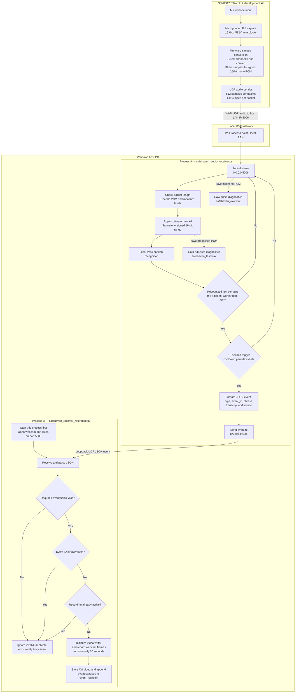

# SafeHaven

### Voice-Triggered Safety Monitoring and Event-Triggered Video Capture with Silicon Labs SiWG917

SafeHaven is an experimental safety-monitoring prototype built with the **Silicon Labs SiWG917 / SiWx917 development kit**. The board captures microphone audio and streams it over Wi-Fi to a Windows host PC. The host performs offline speech recognition and, when a configured phrase containing **“help me”** is recognized, sends a local event to a second application that attempts to record a short webcam clip.

The project demonstrates an end-to-end embedded-to-host workflow: **microphone capture → Wi-Fi audio transport → host-side speech recognition → event validation → video recording and local logging**.

> **Project status:** Experimental prototype. Speech recognition and event decisions run on the host PC, not on the SiWG917. The current implementation does not contact emergency services, send mobile notifications, or guarantee that an emergency phrase will be detected or recorded. It is not a certified alarm, medical alert, or security product.

---

## Contents

- [Features](#features)
- [Live demonstration](#live-demonstration)
- [System architecture](#system-architecture)
- [End-to-end operation](#end-to-end-operation)
- [Hardware and software requirements](#hardware-and-software-requirements)
- [Repository structure](#repository-structure)
- [Setup and installation](#setup-and-installation)
- [Configure, build, and flash the firmware](#configure-build-and-flash-the-firmware)
- [Run SafeHaven](#run-safehaven)
- [Network interfaces and event format](#network-interfaces-and-event-format)
- [Output files and diagnostics](#output-files-and-diagnostics)
- [Testing and validation](#testing-and-validation)
- [Troubleshooting](#troubleshooting)
- [Security, privacy, and safety limitations](#security-privacy-and-safety-limitations)
- [Future improvements](#future-improvements)
- [License and attribution](#license-and-attribution)

---

## Features

- **Embedded audio capture:** Captures microphone samples through the configured SiWG917 microphone/I2S path.
- **Wi-Fi audio streaming:** Sends audio packets from the development kit to the host PC over UDP port `5006`.
- **Offline speech recognition:** Uses the Vosk speech-recognition engine and its local English model on the host PC; the host does not need to call a cloud speech service.
- **Phrase-based trigger:** Checks recognized text for the adjacent words `help me`. Configured examples include “help me”, “please help me”, and “help me please”.
- **Structured local event:** Sends a JSON event from the audio receiver to the camera receiver over host loopback UDP port `5005`.
- **Event validation:** Checks required event fields and ignores malformed messages, event IDs already seen by the running receiver, and events received while a recording is active.
- **Event-triggered recording:** Attempts to save a nominal 10-second webcam clip after a qualifying new event.
- **Local diagnostics:** Stores raw and gain-adjusted audio WAV files, video clips, and a JSON Lines event log.

The project includes diagnostic and demonstration outputs, but it does not yet establish measured detection accuracy, guaranteed latency, or production-level reliability.

## Live demonstration

The demonstration illustrates the host-side phrase trigger, local event transmission, and webcam recording state.

- [Watch the silent SafeHaven demonstration](https://github.com/user-attachments/assets/9b3b8c87-9380-40e7-8c9a-4fe9fc0f1952)
- [Open the demo release](https://github.com/muralikrishnapalisetti/SiWG917-SafeHaven/releases/tag/v1.0.0-demo)

### Phrase detection and event transmission


### Webcam recording in progress


These artifacts show an example run. They do not, on their own, establish recognition accuracy or reliability across different voices, noise levels, and network conditions.

---

## System architecture

This diagram represents the **current implemented design** in the firmware and the two host-side Python applications. The development kit streams audio only; recognition and the decision to trigger recording occur on the host PC.



### End-to-end operation

1. **Start the camera receiver.** It opens the host webcam and listens for event messages on UDP port `5005`.
2. **Start the audio receiver.** It loads the local Vosk model and listens on UDP port `5006`.
3. **Stream audio from the board.** The firmware captures microphone blocks, converts the selected channel into signed 16-bit mono PCM, and sends each packet to the host PC's configured LAN IPv4 address.
4. **Process and recognize audio on the host.** The audio receiver checks packet lengths, records raw audio, applies software gain with 16-bit saturation, records the processed audio, and submits it for speech recognition.
5. **Evaluate the phrase.** Final recognition results are checked. A partial result may also trigger an event when the phrase remains stable across three checks. A 10-second cooldown helps reduce immediate repeated triggers.
6. **Send a local JSON event.** If a trigger qualifies, the audio process sends a message to `127.0.0.1:5005`.
7. **Validate the event.** The camera process checks the expected event type, phrase, source, and event-ID format. It ignores invalid messages, duplicate IDs retained in its in-memory cache, and events received while a recording is already active.
8. **Record and save.** A qualifying event starts a nominal 10-second webcam recording. The camera process saves an AVI file and appends event-status entries to a JSON Lines log.

### Important implementation details

- The firmware is currently configured for 16 kHz audio capture, 512 frames per capture block, and a 1,024-byte signed 16-bit mono audio packet.
- The source code selects channel 0 and shifts each 32-bit I2S sample right by 16 bits. The code comments identify this bit-alignment assumption as a test conversion. **Validate the sample layout, amplitude, and intelligibility on the actual board** before treating the audio path as fully verified.
- The audio and camera applications are separate Python processes on the same host computer. The event sender targets `127.0.0.1:5005`; the board sends audio to the host PC's LAN address on port `5006`.
- UDP does not, by itself, provide guaranteed delivery, sender authentication, or application-level encryption.

---

## Hardware and software requirements

### Hardware

- Silicon Labs SiWG917 / SiWx917 development kit (BRD2605A).
- Windows host PC.
- Webcam supported by OpenCV; the default camera index is `0`.
- Local Wi-Fi network that allows the development kit and PC to exchange UDP traffic.
- USB and power connections required by the development kit.

### Software

- Simplicity Studio and a compatible Silicon Labs SDK/toolchain for the selected board target.
- Python 3.
- Python packages: `vosk` and `opencv-python`.
- Vosk model: `vosk-model-small-en-us-0.15`.

The Vosk model is a runtime dependency downloaded separately; it is not included in this source repository.

## Repository structure

```text
SiWG917-SafeHaven/
├── README.md
├── LICENSE
├── safehaven-trigger-detected.png
├── safehaven-recording-active.png
├── firmware/
│   └── SafeHaven_UDP_Client/
│       ├── SafeHaven_UDP_Client.slcp
│       ├── app.c
│       ├── app.h
│       ├── main.c
│       ├── config/
│       ├── autogen/
│       └── cmake_gcc/
└── host/
    ├── safehaven_audio_receiver.py
    ├── safehaven_receiver_reference.py
    └── vosk-model-small-en-us-0.15/   # Download separately
```

Runtime recordings, logs, WAV files, downloaded speech-recognition data, virtual environments, and generated build outputs should generally remain out of source control unless deliberately prepared as sanitized demonstration assets.

---

## Setup and installation

The instructions below use Windows PowerShell. Run commands from the repository root, the directory containing this `README.md`.

### 1. Create a Python virtual environment

```powershell
py -3 -m venv .venv
.\.venv\Scripts\python.exe -m pip install --upgrade pip
.\.venv\Scripts\python.exe -m pip install vosk opencv-python
```

If `py` is not available, use the path to your installed Python executable to create the environment.

Verify the packages:

```powershell
.\.venv\Scripts\python.exe -c "import vosk, cv2; print('Vosk import: OK'); print('OpenCV:', cv2.__version__)"
```

### 2. Download the Vosk model

1. Open the [official Vosk model list](https://alphacephei.com/vosk/models).
2. Download `vosk-model-small-en-us-0.15.zip`.
3. Extract the model so the following path exists:

```text
host/
└── vosk-model-small-en-us-0.15/
    ├── am/
    ├── graph/
    └── ...
```

From the repository root, verify the placement:

```powershell
Test-Path ".\host\vosk-model-small-en-us-0.15\am"
```

Expected output:

```text
True
```

You can also verify that the model loads:

```powershell
.\.venv\Scripts\python.exe -c "from vosk import Model; Model(r'host/vosk-model-small-en-us-0.15'); print('Vosk model loaded')"
```

---

## Configure, build, and flash the firmware

Open `firmware/SafeHaven_UDP_Client/SafeHaven_UDP_Client.slcp` in Simplicity Studio. Confirm that the selected board target, SDK components, and toolchain are available.

### 1. Configure the host IP address

In `firmware/SafeHaven_UDP_Client/app.c`, locate:

```c
#define SERVER_IP_ADDRESS               "HOST IP ADDRESS HERE"
#define AUDIO_SERVER_PORT               5006U
```

Replace the placeholder with the host PC's **LAN IPv4 address** on the same network as the board.

Do not use `127.0.0.1` for the board destination. Loopback refers to the device itself, not the host PC.

### 2. Configure Wi-Fi credentials

Check the client-profile configuration in `firmware/SafeHaven_UDP_Client/config/sl_net_default_values.h`. The repository contains placeholder values such as:

```c
#define DEFAULT_WIFI_CLIENT_PROFILE_SSID "Your_wifi_name"
#define DEFAULT_WIFI_CLIENT_CREDENTIAL "Your_wifi_password"
```

Use the credentials for your test network in your local build configuration. **Never commit real Wi-Fi passwords, access tokens, or other secrets to a public repository.**

### 3. Build and flash

1. Save the network configuration.
2. Build the firmware project in Simplicity Studio.
3. Resolve any SDK, toolchain, or project configuration errors.
4. Flash the built firmware to the supported development kit.
5. Inspect serial/log output for Wi-Fi connection, microphone initialization, completed sample capture, and UDP transmission messages.

A successful compile alone does not prove that the I2S samples are aligned correctly or that the stream is intelligible. Validate those details on the physical kit.

---

## Run SafeHaven

Start the two host applications in **separate PowerShell windows**. The camera receiver must be started first.

### Window A — Camera event receiver

From the repository root, run:

```powershell
.\.venv\Scripts\python.exe .\host\safehaven_receiver_reference.py
```

Typical startup messages include:

```text
[READY] Listening for voice events on UDP port 5005
[CAMERA] Live preview active.
[ARMED] Say 'help me' to start recording.
```

Keep this process running. If the webcam does not open, close other applications that may be using it and check the configured camera index.

### Window B — Audio receiver

In a second PowerShell window, run:

```powershell
.\.venv\Scripts\python.exe .\host\safehaven_audio_receiver.py
```

Typical startup messages include:

```text
[SafeHaven] Vosk model loaded successfully.
[SafeHaven] Listening on UDP port 5006
[SafeHaven] Expected audio: 16000 Hz, mono, signed 16-bit PCM
[SafeHaven] Say 'help me' to trigger SafeHaven.
```

After the board connects to Wi-Fi and begins streaming, the host receiver should report incoming audio packets.

### Trigger and stop behavior

1. Speak a configured phrase near the development kit's microphone.
2. When a qualifying transcript is recognized and the cooldown allows it, the audio process sends a JSON event to the camera receiver.
3. A valid new event received while the camera receiver is idle starts a nominal 10-second recording.
4. The receiver saves the video and appends status records to the event log.

To stop the camera receiver, focus the camera window and press **Q**. To stop the audio receiver, press **Ctrl+C** in its PowerShell window.

Phrase recognition is not guaranteed. Test in a controlled environment and measure false triggers, missed triggers, and latency before making reliability claims.

---

## Network interfaces and event format

| Data flow | Protocol and endpoint | Purpose |
|---|---|---|
| Development kit → host audio receiver | UDP to host LAN IPv4, port `5006` | PCM audio packets |
| Audio receiver → camera receiver | UDP to `127.0.0.1:5005` | Local JSON event |
| Camera receiver listener | Binds to UDP port `5005` | Receives event messages on the host |

The audio receiver binds to `0.0.0.0:5006`, so the host listens on its IPv4 interfaces. The camera receiver binds to port `5005`, while the audio process sends events to loopback because both programs are expected to run on the same PC. Keep the two host applications on that same computer for this setup.

### Example JSON event

```json
{
  "type": "SAFEHAVEN_VOICE_EVENT",
  "event_id": "voice-123456789",
  "phrase": "HELP_ME",
  "transcript": "help me",
  "source": "siwx917_microphone"
}
```

The event ID in this example is illustrative; the application generates a new ID at runtime.

The camera receiver checks that:

- `type` equals `SAFEHAVEN_VOICE_EVENT`.
- `phrase` equals `HELP_ME`.
- `source` equals `siwx917_microphone`.
- `event_id` is a 1–100 character string containing only letters, digits, underscores, or hyphens.

The transcript may be recorded in the log, but it is not one of the required validation fields. Field validation checks message structure; it does not authenticate the sender.

---

## Output files and diagnostics

### Video and event log

The camera application writes files under `host/safehaven_events/`:

```text
host/safehaven_events/
├── SafeHaven_<timestamp>_<event-id>.avi
└── event_log.jsonl
```

- The AVI file contains the intended 10-second clip if the webcam, frame capture, video writer, and storage all operate successfully.
- `event_log.jsonl` stores one JSON object per line. Status entries can include `TRIGGER_RECEIVED`, `RECORDING_STARTED`, `RECORDING_COMPLETED`, and `RECORDING_FAILED`.
- Event IDs are cached in memory while the camera receiver process is running to help suppress duplicate events.

### Audio diagnostic files

The audio receiver writes two files under `host/`:

- `safehaven_raw.wav` — incoming PCM before software gain.
- `safehaven_test.wav` — audio after gain and signed 16-bit saturation.

Console diagnostics include packet counts, packet lengths, raw and processed RMS levels, peak levels, and the count of samples clipped by gain. These measures help investigate signal level and packet delivery; they do not, by themselves, prove correct sample alignment or reliable recognition.

---

## Testing and validation

The demonstration screenshots and linked video show an example of phrase detection, event transmission, and recording initiation. They are not a substitute for a measured test campaign.

For repeatable evaluation, record the board and SDK versions, host OS and Python version, number of trials, successful detections, false triggers, missed triggers, detection latency, packet loss, and whether the expected video and log files were created. Do not publish accuracy or reliability figures without a defined test set and recorded results.

| Test scenario | What to verify |
|---|---|
| Normal conversation | Whether unintended triggers occur |
| Each configured phrase | Whether recognition sends an event |
| Background noise or different speaking distances | False triggers and missed detections |
| Board disconnect or Wi-Fi loss | Whether packet loss or missing audio is visible in logs |
| Valid and malformed JSON | Valid events are accepted; invalid fields are rejected |
| Repeated event ID | Duplicate handling works as intended |
| Recording output | Video file exists, plays, and is close to the intended duration |
| Webcam unavailable or storage unwritable | The failure is visible in logs |

---

## Troubleshooting

| Symptom | Likely cause | What to check |
|---|---|---|
| Vosk model missing or incomplete | Model not downloaded or extracted into an extra nested folder | Confirm `host/vosk-model-small-en-us-0.15/am/` exists |
| `ModuleNotFoundError: No module named 'vosk'` | Package installed into a different Python environment | Use `.venv\Scripts\python.exe` for both installation and execution |
| Audio receiver waits for packets | Packets do not reach host UDP port `5006` | Check board Wi-Fi, host LAN IP, destination port, firewall rules, and board logs |
| Packets arrive but no event triggers | Audio may be quiet, distorted, misaligned, or not intelligible | Inspect the WAV files and RMS/peak diagnostics; validate the firmware sample conversion |
| Camera preview fails | Webcam is unavailable or used by another application | Close other camera applications and check camera index |
| Address already in use | Another process owns port `5005` or `5006` | Stop stale SafeHaven processes or identify the process using the port |
| Event is sent but no recording starts | Camera receiver is not ready or rejects the event | Check both consoles, event fields, and whether recording is already active |
| Event is accepted but video output fails | Video writer, frame capture, or storage failed | Check webcam state, directory permissions, and receiver logs |
| Microphone capture fails | I2S/capture initialization or sample-ready path failed | Review serial logs and target-specific SDK configuration |

---

## Security, privacy, and safety limitations

SafeHaven is an experimental prototype. It is not a certified alarm, medical alert, CCTV, or emergency-response product.

- **No sender authentication:** The camera receiver validates selected event fields but does not cryptographically prove who sent the message. A sender with access to the listener may be able to forge an event.
- **No application-level encryption:** The current UDP audio and event channels do not add application-level encryption or integrity protection.
- **Local storage only:** In the current workflow, recordings and event logs are saved on the host PC. The system does not deliver clips to a registered phone, remote backup, or cloud service.
- **Recognition uncertainty:** Noise, accents, microphone placement, incorrect sample conversion, or packet loss can cause false positives or missed detections.
- **Availability dependencies:** Host shutdown, Wi-Fi loss, webcam failure, or insufficient storage can interrupt the workflow.
- **Privacy:** Inform people when a camera is in use, obtain appropriate consent, restrict access to saved clips, and define retention/deletion rules.
- **Emergency limitations:** The application does not contact emergency services and must not be the only way to request assistance.

Use the prototype only in a controlled, trusted test environment. A deployment-oriented implementation would need a threat model, authenticated and replay-resistant event messages, protected transport, robust recovery behavior, and systematic performance testing.

---

## Future improvements

1. **Validate the embedded audio path:** Confirm I2S sample alignment, channel selection, audio level, intelligibility, and packet behavior on the physical kit.
2. **Measure baseline performance:** Record trigger latency, false triggers, missed triggers, packet loss, and successful video recordings over a defined test set.
3. **Improve event security:** Add message authentication and replay protection, and evaluate a suitable protected transport.
4. **Add optional notifications:** Design secure delivery to a registered phone with clear consent, access control, and retention rules.
5. **Add a local alert output:** Evaluate a buzzer or other local indicator, with safe handling of repeated or accidental triggers.
6. **Improve resilience:** Test Wi-Fi loss, process restarts, camera failures, and low-storage conditions.
7. **Publish reproducible demonstrations:** Document the exact hardware/software versions and distinguish observed behavior from performance that has not yet been measured.

---

## License and attribution

The root-level `LICENSE` file applies to original SafeHaven code and documentation authored by the project contributor, subject to the exceptions stated in that file. Silicon Labs SDK files, vendor examples, generated files, and third-party dependencies remain subject to their own applicable copyright notices and license terms.

The firmware project is based on a Silicon Labs Wi-Fi example and has been adapted for this prototype. Preserve the original source-file notices and review the applicable licenses before redistributing SDK or example code. Documentation inherited from the source example is not evidence that the corresponding measurements or procedures have been performed for SafeHaven.

---

## Project summary

| Item | Current implementation |
|---|---|
| Project | SafeHaven |
| Embedded platform | Silicon Labs SiWG917 / SiWx917 development kit (BRD2605A) |
| Audio capture | Microphone/I2S path, 16 kHz configuration |
| Audio transport | Wi-Fi UDP, host port `5006` |
| Audio format expected by host | Mono, signed 16-bit PCM |
| Speech recognition | Offline Vosk engine on the Windows host PC |
| Trigger condition | Recognized text contains the adjacent words `help me` |
| Host event transport | Localhost UDP port `5005` |
| Event action | Validate event and attempt nominal 10-second webcam recording |
| Saved outputs | AVI clip, JSON Lines event log, raw and processed WAV diagnostics |
| Mobile notifications | Not implemented |
| Buzzer/local alarm | Not implemented |
| Emergency-service contact | Not implemented |
